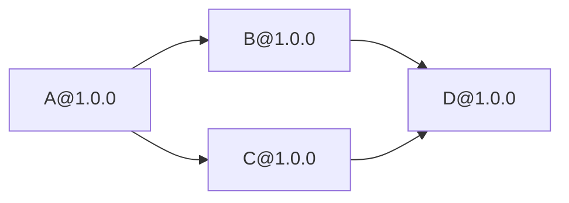
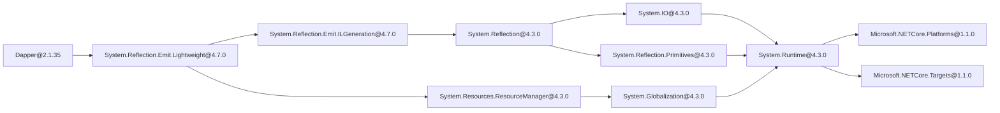

# Визуализатор графа зависимостей NuGet

Практическая работа по дисциплине
**«Конфигурационное управление»**

**Вариант №22**

Проект представляет собой консольное приложение на Python для
получения, анализа и визуализации графа зависимостей пакетов NuGet.

Программа:

- читает настройки из XML;
- получает информацию через NuGet V3 API;
- определяет прямые зависимости;
- строит полный граф транзитивных зависимостей;
- обрабатывает циклы;
- поддерживает тестовый репозиторий;
- находит обратные зависимости;
- формирует D2-представление;
- сохраняет граф в PNG;
- выводит ASCII-дерево.

Для получения зависимостей готовые менеджеры пакетов и сторонние
Python-библиотеки не используются.

---

# Этап 1. Конфигурация

Пользовательские параметры хранятся в XML-файле.

Пример `config.xml`:

```xml
<?xml version="1.0" encoding="UTF-8"?>
<config>
    <package>Newtonsoft.Json</package>
    <repository>https://api.nuget.org/v3/index.json</repository>
    <test_mode>false</test_mode>
    <version>13.0.3</version>
    <output_file>dependencies.png</output_file>
    <ascii_tree>true</ascii_tree>
</config>
```

## Параметры

- `package` — имя анализируемого пакета;
- `repository` — URL NuGet или путь к тестовому репозиторию;
- `test_mode` — режим тестового репозитория;
- `version` — версия пакета;
- `output_file` — имя выходного PNG-файла;
- `ascii_tree` — вывод ASCII-дерева.

## Обработка ошибок

Проверяются:

- наличие XML-файла;
- корректность XML;
- наличие обязательных параметров;
- пустые значения;
- логические параметры;
- URL репозитория;
- наличие тестового репозитория;
- расширение выходного файла.

Основная реализация:

```text
src/config.py
```

---

# Этап 2. Получение прямых зависимостей

На втором этапе реализовано получение прямых зависимостей
заданной версии пакета через NuGet V3 API.

Программа:

1. загружает Service Index;
2. находит `RegistrationsBaseUrl`;
3. получает регистрационные данные пакета;
4. находит заданную версию;
5. извлекает прямые зависимости.

Для зависимости сохраняются:

- имя пакета;
- диапазон версий;
- целевая платформа.

Используются только средства стандартной библиотеки Python,
включая `urllib` и `json`.

Основная реализация:

```text
src/nuget.py
```

---

# Этап 3. Полный граф зависимостей

На третьем этапе реализовано построение полного графа
с учётом транзитивных зависимостей.

Для обхода используется рекурсивный DFS.

Основная реализация:

```text
src/graph.py
```

## Формат узлов

Узел графа содержит пакет и версию:

```text
Package@Version
```

Примеры:

```text
Newtonsoft.Json@13.0.3
Dapper@2.1.35
A@1.0.0
```

## Обработка циклов

Алгоритм использует множество:

```text
visited
```

Если узел уже посещён, повторный рекурсивный обход
не выполняется.

Например:

```text
A@1.0.0 -> B@1.0.0
B@1.0.0 -> C@1.0.0
C@1.0.0 -> A@1.0.0
```

такой граф не вызывает бесконечной рекурсии.

## Диапазоны версий

Для поддерживаемых диапазонов NuGet выбирается
минимальная допустимая версия.

Примеры:

```text
[4.3.0, ) -> 4.3.0
[1.6.1, ) -> 1.6.1
[2.0.0] -> 2.0.0
```

## Тестовый репозиторий

В тестовом режиме используется локальный JSON.

Пример:

```json
{
    "A": {
        "1.0.0": ["B@1.0.0", "C@1.0.0"]
    },
    "B": {
        "1.0.0": ["D@1.0.0"]
    },
    "C": {
        "1.0.0": ["D@1.0.0"]
    },
    "D": {
        "1.0.0": []
    }
}
```

Проверяются:

- имя пакета;
- наличие пакета;
- наличие версии;
- формат зависимостей;
- наличие зависимого пакета;
- наличие версии зависимости.

При отсутствии версии:

```text
Ошибка: Версия пакета не найдена: A 9.9.9
```

Тестовые репозитории:

```text
tests/repositories/simple.json
tests/repositories/deep.json
tests/repositories/cycle.json
```

---

# Этап 4. Обратные зависимости

На четвёртом этапе реализован поиск пакетов,
которые зависят от указанного узла.

Например:

```text
A -> B
A -> C
B -> D
C -> D
```

Для `D` обратными зависимостями являются:

```text
B
C
A
```

## Алгоритм

Сначала направления рёбер разворачиваются.

Исходный граф:

```text
A -> B
B -> D
C -> D
```

Развёрнутый:

```text
B -> A
D -> B, C
```

После этого используется тот же DFS,
который был реализован на этапе 3.

Функции:

```text
reverse_graph()
build_reverse_dependency_graph()
```

находятся в:

```text
src/graph.py
```

## Проверка этапа 4

Автоматические тесты:

```powershell
py -m unittest discover -s tests -p "test_graph.py" -v
```

Простой граф:

```powershell
.\run.bat --config tests\config_stage3_simple.xml --reverse D@1.0.0
```

Глубокий граф:

```powershell
.\run.bat --config tests\config_stage3_deep.xml --reverse E@1.0.0
```

Циклический граф:

```powershell
.\run.bat --config tests\config_stage3_cycle.xml --reverse B@1.0.0
```

Проверка ошибки:

```powershell
.\run.bat --config tests\config_stage3_simple.xml --reverse Z@1.0.0
```

---

# Этап 5. Визуализация

На пятом этапе реализовано графическое представление
графа зависимостей.

Основная реализация:

```text
src/visualization.py
```

Поддерживаются:

- D2;
- PNG;
- ASCII-дерево;
- обработка циклов;
- обработка ошибок D2 CLI.

---

# D2-представление

Функция:

```text
graph_to_d2()
```

преобразует внутренний граф программы в D2.

Например:

```text
A@1.0.0 -> B@1.0.0
B@1.0.0 -> D@1.0.0
```

формируется как:

```text
direction: right
"A@1.0.0" -> "B@1.0.0"
"B@1.0.0" -> "D@1.0.0"
```

Текст сохраняется функцией:

```text
save_d2_source()
```

---

# Создание PNG

Для генерации изображения используется D2 CLI.

Проверка установки:

```powershell
d2 version
```

Использованная версия:

```text
v0.9.0
```

Для больших графов используется масштаб:

```text
--scale 0.5
```

PNG создаётся функцией:

```text
render_d2()
```

---

# ASCII-дерево

Если в XML указано:

```xml
<ascii_tree>true</ascii_tree>
```

программа дополнительно выводит дерево зависимостей.

Пример:

```text
A@1.0.0
├── B@1.0.0
│   └── D@1.0.0
└── C@1.0.0
    └── D@1.0.0
```

При обнаружении цикла используется пометка:

```text
[cycle]
```

Для демонстрации используется:

```text
tests/config_stage5_ascii.xml
```

Запуск:

```powershell
.\run.bat --config tests\config_stage5_ascii.xml
```

---

# Граф 1. Тестовый граф

Ниже приведено схематическое представление
тестового графа.

Фактически программа формирует его в D2
и сохраняет в PNG.



Конфигурация:

```text
tests/config_stage5_ascii.xml
```

Создаваемые программой файлы:

```text
output/stage5_simple.d2
output/stage5_simple.png
```

---

# Граф 2. Dapper 2.1.35

Для второго примера используется реальный NuGet-пакет:

```text
Dapper 2.1.35
```

Конфигурация:

```text
tests/config_stage5_dapper.xml
```

Запуск:

```powershell
.\run.bat --config tests\config_stage5_dapper.xml
```

Основная часть полученного графа:



Программа создаёт:

```text
output/dapper.d2
output/dapper.png
```

---

# Дополнительные реальные пакеты

Визуализация также была проверена на:

```text
Newtonsoft.Json 13.0.3
Microsoft.Extensions.Logging.Abstractions 8.0.0
```

Конфигурации:

```text
tests/config_stage5_newtonsoft.xml
tests/config_stage5_logging.xml
```

Запуск:

```powershell
.\run.bat --config tests\config_stage5_newtonsoft.xml
.\run.bat --config tests\config_stage5_logging.xml
```

Программа создаёт:

```text
output/newtonsoft.d2
output/newtonsoft.png
output/logging_abstractions.d2
output/logging_abstractions.png
```

Таким образом, визуализация была проверена
на трёх различных реальных NuGet-пакетах.

---

# Сравнение со штатным NuGet

Для проверки результата использовался отдельный
.NET-проект:

```text
DapperCompare
```

Целевая платформа:

```text
netstandard2.0
```

Версия .NET SDK:

```text
10.0.403
```

В проект был добавлен:

```text
Dapper 2.1.35
```

## Список пакетов

Команда:

```powershell
dotnet package list --include-transitive
```

Штатный инструмент показал:

```text
Dapper 2.1.35
NETStandard.Library 2.0.3
Microsoft.NETCore.Platforms 1.1.0
System.Reflection.Emit.ILGeneration 4.7.0
System.Reflection.Emit.Lightweight 4.7.0
```

## Проверка конкретной цепочки

Команда:

```powershell
dotnet nuget why System.Reflection.Emit.Lightweight
```

Результат:

```text
[netstandard2.0]
└── Dapper 2.1.35
    └── System.Reflection.Emit.Lightweight 4.7.0
```

Эта зависимость присутствует и в графе,
построенном разработанной программой.

---

# Причины различий

Штатный `dotnet` строит граф для:

- конкретного проекта;
- определённой target framework;
- конкретного результата восстановления NuGet.

В сравнении используется:

```text
netstandard2.0
```

Разработанная программа работает непосредственно
с NuGet V3 API и анализирует метаданные пакетов.

Она не ограничивает исходный граф одной target framework.

Кроме того, для поддерживаемых диапазонов выбирается
минимальная допустимая версия.

Поэтому полный граф программы может быть шире,
чем граф конкретного .NET-проекта.

---

# Тестирование

## Тесты этапа 4

```powershell
py -m unittest discover -s tests -p "test_graph.py" -v
```

## Тесты этапа 5

```powershell
py -m unittest discover -s tests -p "test_visualization.py" -v
```

## Все тесты

```powershell
py -m unittest discover -s tests -v
```

Финальный результат:

```text
Ran 49 tests
OK
```

---

# Сгенерированные файлы

Файлы:

```text
*.d2
*.png
output/
```

не добавляются в Git.

Они находятся в `.gitignore`.

Графы в данном README отображаются средствами Mermaid,
поэтому дополнительные бинарные файлы
для отображения схем на GitHub не требуются.

---

# Запуск

Обычный запуск:

```powershell
.\run.bat
```

Запуск с конкретной конфигурацией:

```powershell
.\run.bat --config tests\config_stage5_dapper.xml
```

Прямой запуск Python:

```powershell
py -m src.main
```

---

# Структура проекта

```text
config-management-dependencies/
├── src/
│   ├── __init__.py
│   ├── config.py
│   ├── graph.py
│   ├── main.py
│   ├── nuget.py
│   ├── test_repository.py
│   └── visualization.py
│
├── tests/
│   ├── repositories/
│   │   ├── cycle.json
│   │   ├── deep.json
│   │   └── simple.json
│   │
│   ├── config_stage3_cycle.xml
│   ├── config_stage3_deep.xml
│   ├── config_stage3_missing_version.xml
│   ├── config_stage3_simple.xml
│   ├── config_stage5_ascii.xml
│   ├── config_stage5_dapper.xml
│   ├── config_stage5_logging.xml
│   ├── config_stage5_newtonsoft.xml
│   ├── test_config.py
│   ├── test_graph.py
│   ├── test_nuget.py
│   ├── test_test_repository.py
│   └── test_visualization.py
│
├── .gitignore
├── README.md
├── config.xml
└── run.bat
```

---

# Основные файлы

- `src/main.py` — точка входа;
- `src/config.py` — XML-конфигурация;
- `src/nuget.py` — NuGet V3 API;
- `src/graph.py` — операции над графом;
- `src/test_repository.py` — тестовый репозиторий;
- `src/visualization.py` — D2, PNG и ASCII;
- `tests/` — автоматические тесты;
- `run.bat` — запуск приложения.

---

# Вывод

В ходе выполнения практической работы разработано
приложение для анализа зависимостей пакетов NuGet.

Реализованы:

- XML-конфигурация;
- работа с NuGet V3 API;
- прямые зависимости;
- транзитивные зависимости;
- рекурсивный DFS;
- обработка циклов;
- тестовый репозиторий;
- проверка версий;
- обратные зависимости;
- D2-представление;
- PNG-визуализация;
- ASCII-дерево;
- сравнение со штатными средствами NuGet.

Программа протестирована на реальных пакетах
и на специально подготовленных тестовых графах.